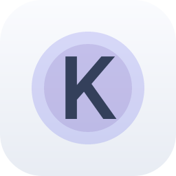

# Kev Decision Models
<p align="center">
  <picture>
    <source media="(prefers-color-scheme: dark)" srcset="./icon-dark.png" />
    
  </picture>
</p>

This plugin connects the Ryu **Decision Models** layer to a Kev server already running on the
selected node. Kev uses the System One request format, so agents call the same stable
`decision.predict` verb used by Laya, Ollaya, and Cloudflare Clef.

## Start Kev

Install Kev from its official repository and start a model server on the selected Ryu node. For
example, Kev documents this command for Kev-4B:

```sh
uv run --extra serve python -m kev.serve --run jaredpalmer/kev-4b --port 8009
```

The first run downloads the Kev model and its Qwen base model. Ryu does not install those weights or
start the Kev process. The provider expects the documented local address
`http://127.0.0.1:8009` and calls `/v1/systemone` and `/v1/models` there.

## Configure

Enable **Kev Decision Models** after the local server is ready. The shipped connector supports a
keyless Kev server over loopback HTTP. Core does not send API keys over plaintext HTTP, so a Kev
server configured with `KEV_API_KEY` is not supported by this connector until an HTTPS transport is
available. Ryu does not store or send a Kev API key.

Ryu sends `model: "kev-latest"` by default, which Kev uses for the checkpoint loaded by the server.
State and typed questions stay on the node. If Kev is stopped or the model is unavailable, the
selected provider returns an error; Ryu does not fall back to another model.

## References

- [Kev source and setup guide](https://github.com/jaredpalmer/kev)
- [Kev model collection](https://huggingface.co/collections/jaredpalmer/kev-6aad9d)
- [Kev-0.8B](https://huggingface.co/jaredpalmer/kev-0.8b), [Kev-4B](https://huggingface.co/jaredpalmer/kev-4b), [Kev-9B](https://huggingface.co/jaredpalmer/kev-9b), and [Kev-27B](https://huggingface.co/jaredpalmer/kev-27b)
